<div dir="rtl">

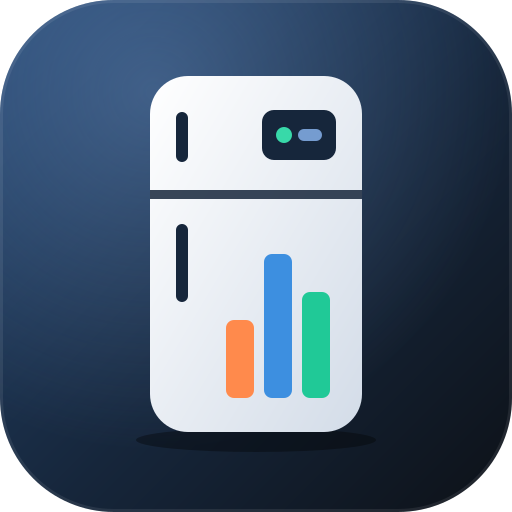

# Kelvin — مراقبة الثلاجة الذكية

**IoT Based Smart Food Storage and Waste Reduction**

لوحة تحكم لثلاجة ذكية: جهاز **ESP32** يقرأ الحرارة والرطوبة (**DHT11**) وجودة الهواء (**CCS811**) ويرسلها للموقع. الموقع يعرضها مباشرة، ويتوقع القراءات الجاية، وينبّهك على **تلكرام** و **ntfy** قبل ما يخرب الأكل.

🔗 **الموقع:** https://kelvin-smart-fridge.vercel.app (النسخة القديمة على Netlify: https://kelvin-smart-fridge.netlify.app)

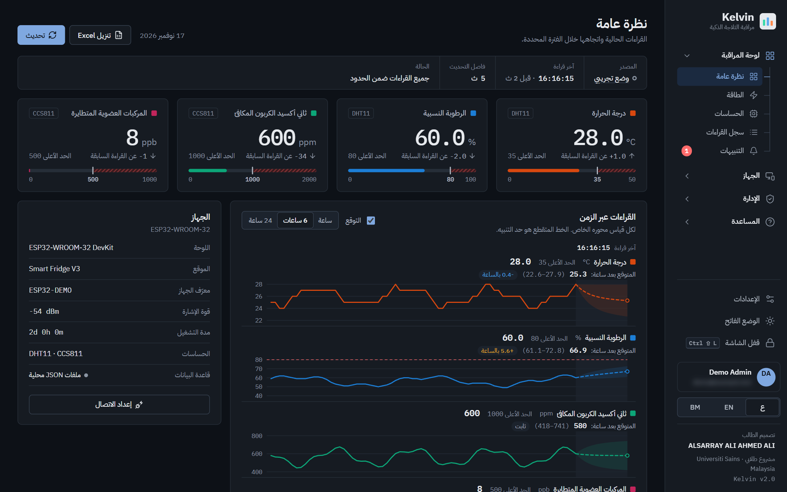

## المزايا

- **قراءات مباشرة** لأربع حساسات مع حدود تنبيه ورسم بياني لساعة أو 6 ساعات أو 24 ساعة.
- **مقارنة الفترات:** الرسم ويه الفترة السابقة أو أمس أو الأسبوع الماضي، والفرق بالمعدل.
- **توقع القراءات الجاية** على الرسم (خط اتجاه ومدى ثقة 95%)، وتحذير مثل «ممكن يتجاوز الحد خلال ~45 دقيقة».
- **تنبيهات على تلكرام و ntfy** (إشعارات على الموبايل)، ورسالة لما الوضع يرجع طبيعي.
- **استهلاك الطاقة** لكل قطعة وكلفته باليوم والشهر، بدون حساس طاقة.
- **تصدير Excel** بأربع أوراق: القراءات، الملخص، الطاقة (بمعادلات)، والرسوم البيانية.
- **قراءة ثابتة كل دقيقة:** السيرفر يحفظ قراءة وحدة ببداية كل دقيقة ويگول للجهاز متى الجاية، وما أحد يكدر يغيرها من الموقع. (حوالي 43 ألف طلب بالشهر، ضمن خطة Vercel المجانية.)
- **حسابات وصلاحيات:** مدير، مشغّل، مشاهد. الانضمام بدعوة على البريد، والتحقق بخطوتين، واستعادة كلمة السر، وقفل الشاشة بـ PIN.
- **الدعم الفني:** بلاغ عطل يوصل لبوت تلكرام خاص بقسم تقنية المعلومات.
- **أوسمة** تشجّع على الاستخدام، مثل أيام الاستخدام والسلاسل المتتالية.
- **ثلاث لغات** (عربي، English، Melayu)، ووضع فاتح وداكن، ويشتغل على الموبايل والآيباد.
- **حماية:** كلمات السر مُجزّأة (scrypt)، وإيقاف الحساب بعد 5 محاولات غلط، وإيميل عند الدخول من جهاز جديد، وسجل أمان للمدير، ومفتاح جهاز قابل للاستبدال، ورؤوس CSP و HSTS، وجلسات HttpOnly.

## صور

| | |
|:---:|:---:|
| 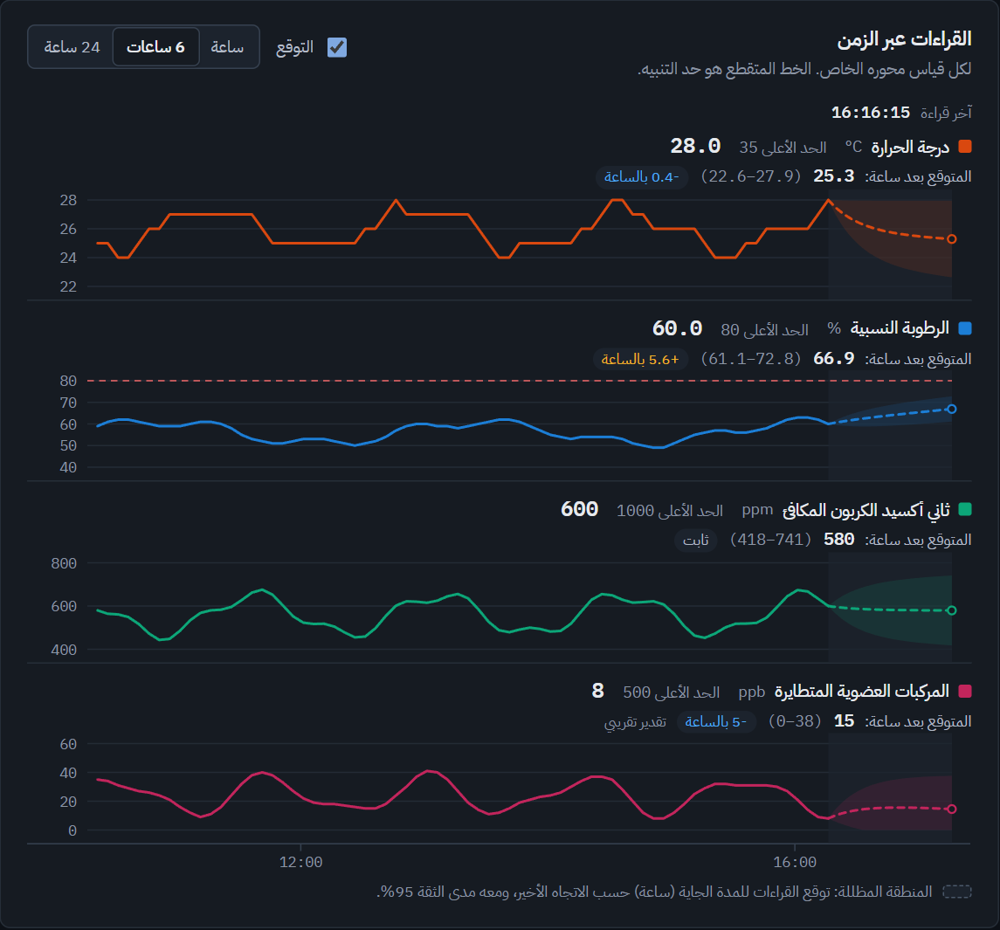<br>التوقع بالرسم البياني | 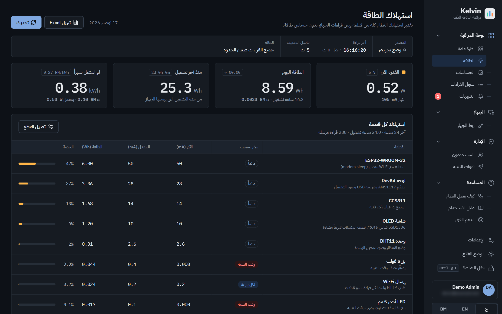<br>استهلاك الطاقة |
| 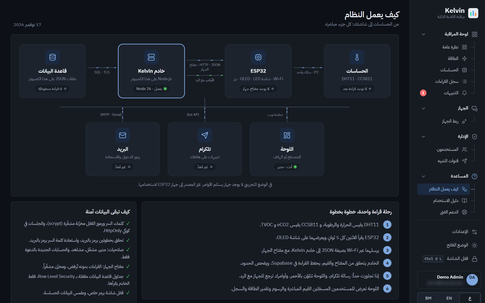<br>كيف يعمل النظام | 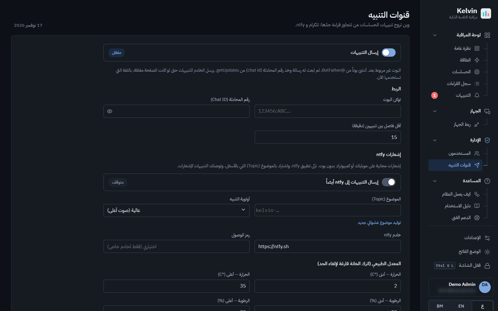<br>قنوات التنبيه (تلكرام و ntfy) |
| 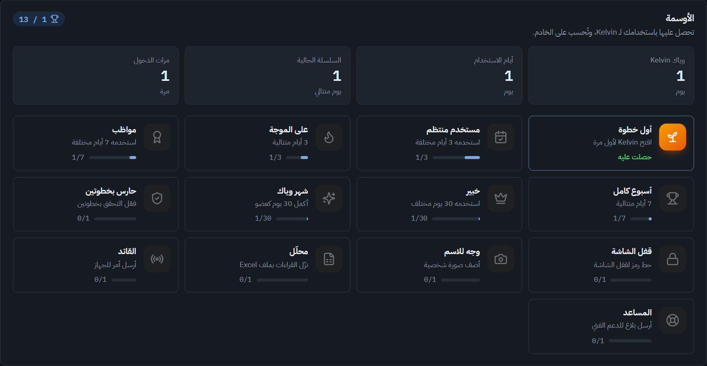<br>الأوسمة | 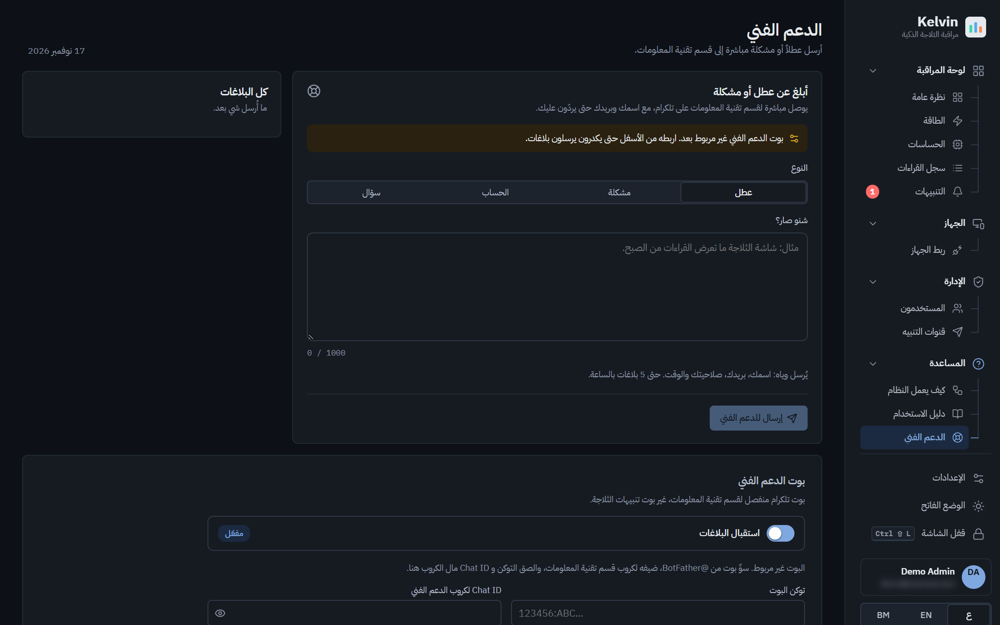<br>الدعم الفني |
| 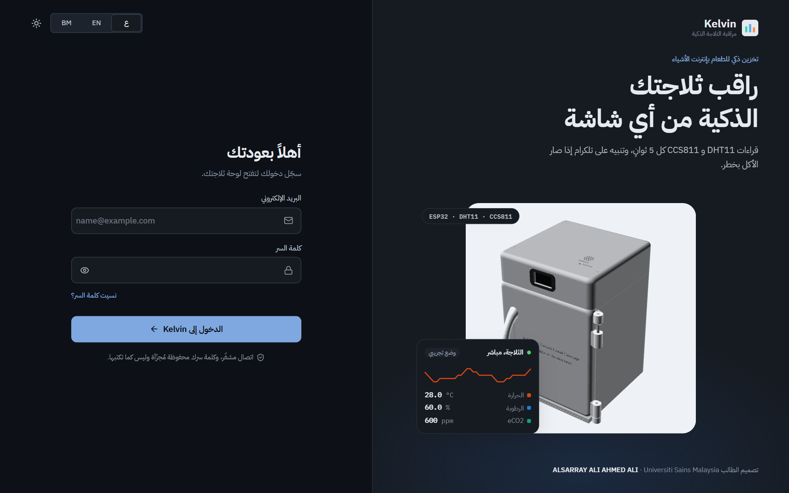<br>تسجيل الدخول | 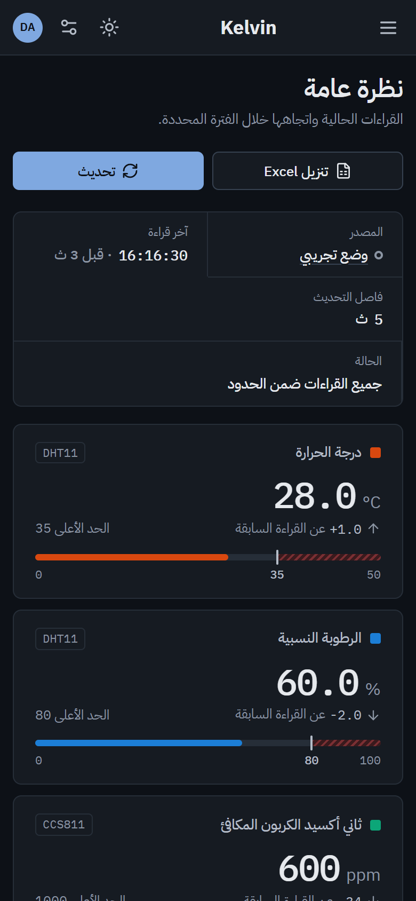 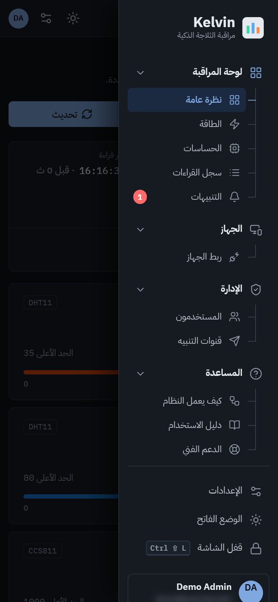<br>على الموبايل |

## كيف يشتغل

```
DHT11 + CCS811 → ESP32 ──HTTPS──► Vercel / Netlify Function (Node) ──► Supabase (PostgreSQL)
                    ▲                        │
                    └─ موعد الإرسال الجاي ──┤──► اللوحة (React)
                                             └──► تلكرام · ntfy · البريد
```

- **الجهاز:** ESP32-WROOM-32، DHT11، CCS811، وشاشة OLED SSD1306. برنامج Arduino يتولّد من صفحة «ربط الجهاز».
- **الموقع:** React 19 و TypeScript و Vite، والخادم Node على Vercel أو Netlify Functions (نفس الكود)، وقاعدة البيانات Supabase.

## التشغيل على جهازك

```bash
npm install
cp .env.example .env   # ضيف رابط قاعدة البيانات وإعدادات البريد
npm run dev            # http://localhost:5173
```

الاختبارات: `npm test`. الشرح الكامل (Supabase، Gmail، تلكرام، ntfy، Netlify، Vercel، الصلاحيات): **[docs/SETUP.md](docs/SETUP.md)**.

---

تصميم الطالب **ALSARRAY ALI AHMED ALI** · Universiti Sains Malaysia

</div>
