<div align="center">


# Kelvin — Smart Fridge Monitor

**IoT-based smart food storage and waste reduction**

An ESP32 reads the temperature, humidity and air quality inside a fridge. Kelvin shows those readings live, forecasts where they are heading, works out the device's energy use, and alerts you on Telegram and ntfy before the food spoils.

[](https://kelvin-smart-fridge.vercel.app)


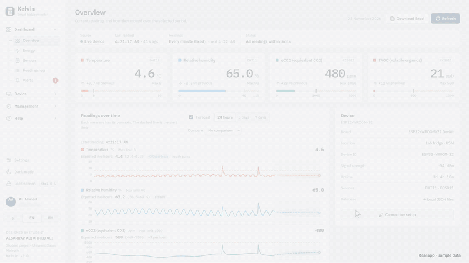

</div>

---

## Contents

- [Watch the film](#-watch-the-film)
- [The app in motion](#-the-app-in-motion)
- [Features](#-features)
- [How it works](#-how-it-works)
- [Why this technology](#-why-this-technology)
- [Security](#-security)
- [Run it yourself](#-run-it-yourself)
- [Project structure](#-project-structure)
- [Tests](#-tests)

---

## 🎬 Watch the film

<div align="center">

[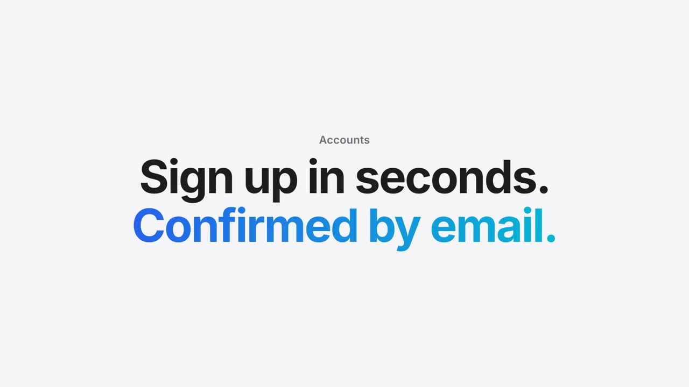](docs/video/kelvin-keynote.mp4)

**Kelvin, the keynote (3:55).** A calm walkthrough of the real app, cut to an original score. A 4K master is also available.

| [🎞️ Promo (1:20)](docs/video/kelvin-promo.mp4) | [🎬 Full demo (2:09)](docs/video/kelvin-demo.mp4) |
|:---:|:---:|
| [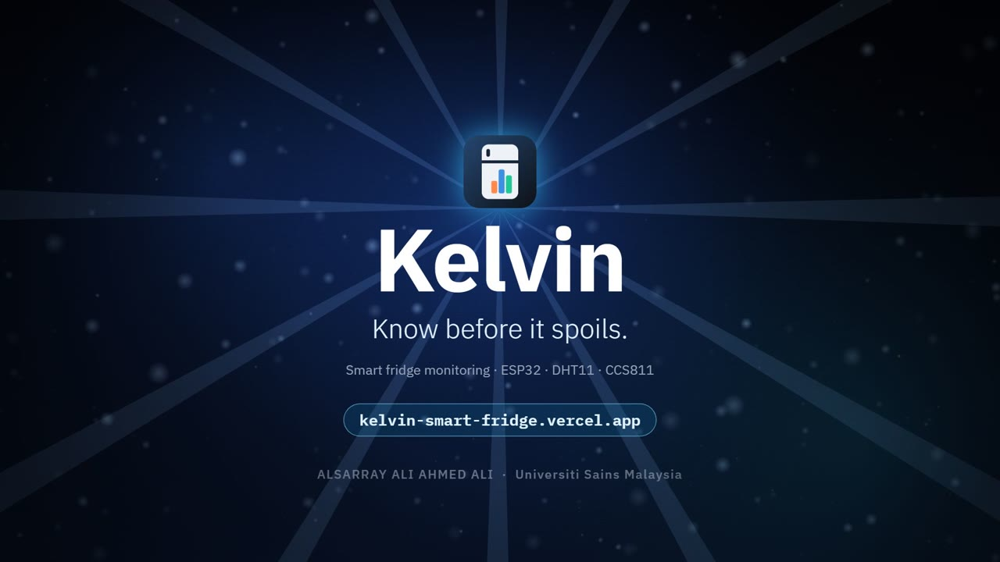](docs/video/kelvin-promo.mp4) | [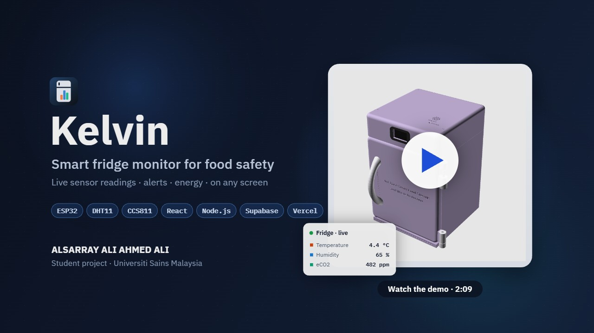](docs/video/kelvin-demo.mp4) |

</div>

Every screen in the films and GIFs is the real app running on sample data. The films are built in code with [Remotion](https://www.remotion.dev) and FFmpeg; the source is in [`promo-video/`](promo-video/).

---

## ✨ The app in motion

<table>
<tr>
<td width="50%">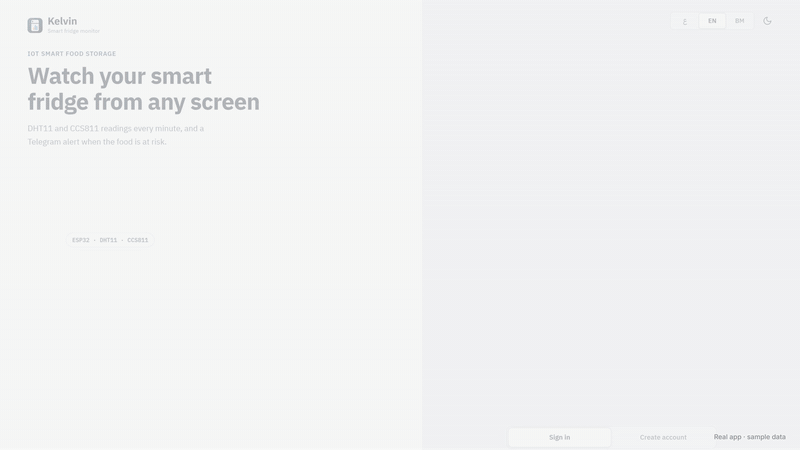<br><b>Sign up in seconds.</b> Each new account is confirmed with a 6-digit code sent by email.</td>
<td width="50%">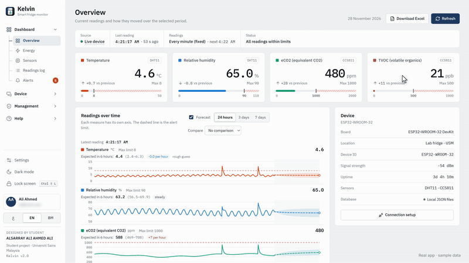<br><b>Every moment, on one chart.</b> Hover any point. The forecast shows the next six hours with a 95% range.</td>
</tr>
<tr>
<td>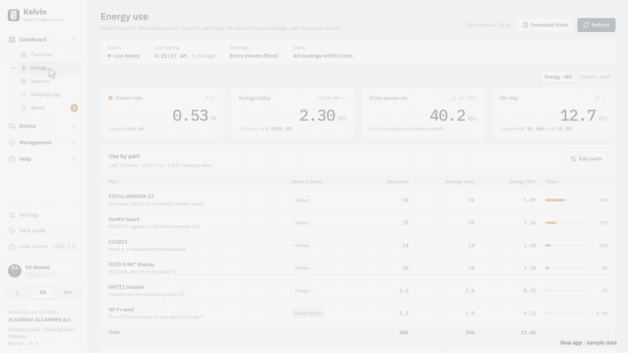<br><b>Energy without a power sensor.</b> Worked out part by part from each datasheet, in Wh or mAh.</td>
<td>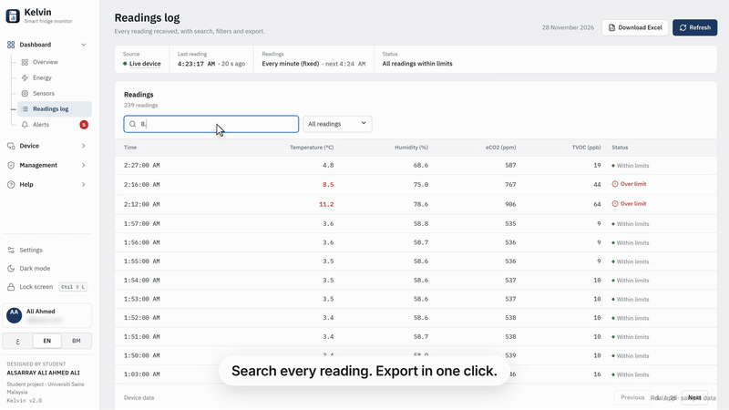<br><b>One-click Excel export.</b> Four sheets: readings, summary, energy with live formulas, and charts.</td>
</tr>
<tr>
<td>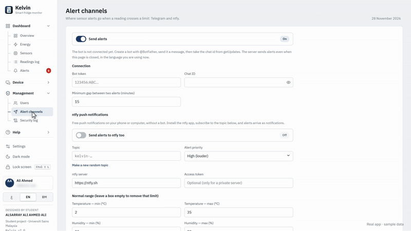<br><b>Alerts, written your way.</b> Write the message with tags and watch the preview update live.</td>
<td>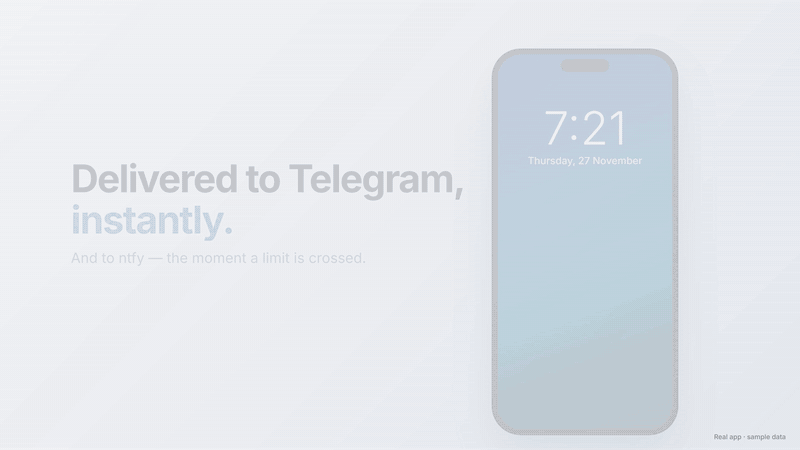<br><b>Delivered instantly.</b> To Telegram and ntfy the moment a limit is crossed, plus a note when it recovers.</td>
</tr>
<tr>
<td>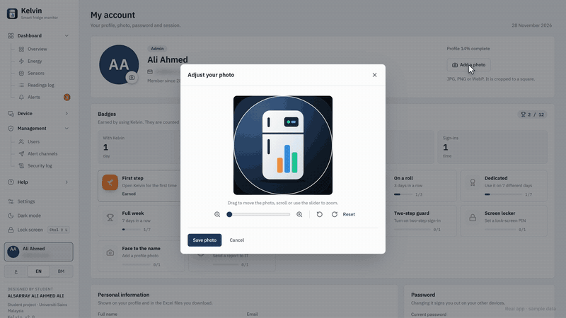<br><b>Make it yours.</b> Crop a profile photo, earn 12 badges, and keep private details blurred.</td>
<td>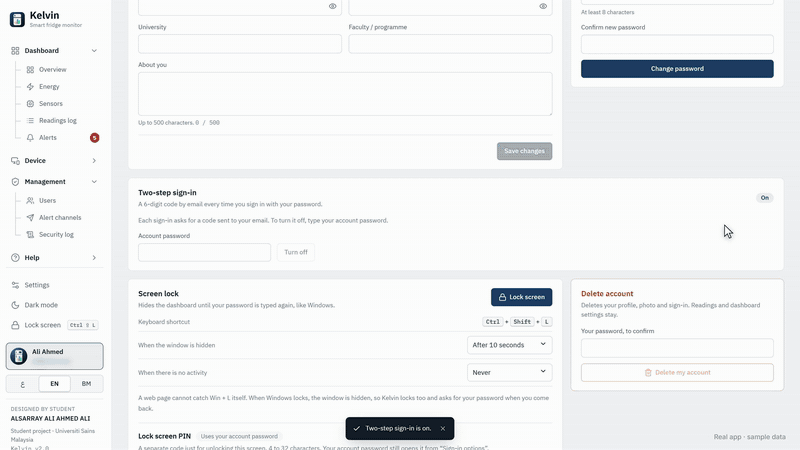<br><b>Ctrl + Shift + L locks the screen.</b> It also locks itself when the window is hidden.</td>
</tr>
<tr>
<td>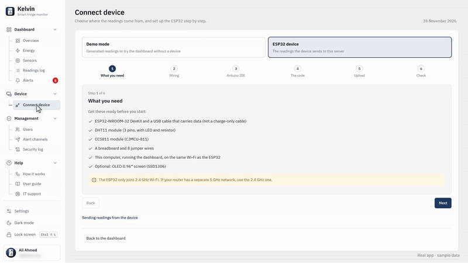<br><b>Connect the ESP32 step by step.</b> The Arduino code is generated with your Wi-Fi and device key filled in.</td>
<td>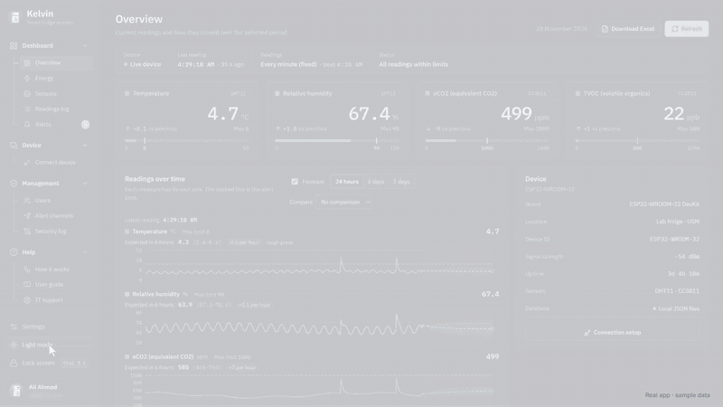<br><b>Any language, any theme.</b> English, العربية (right to left) and Bahasa Melayu, in light and dark.</td>
</tr>
</table>

<div align="center">
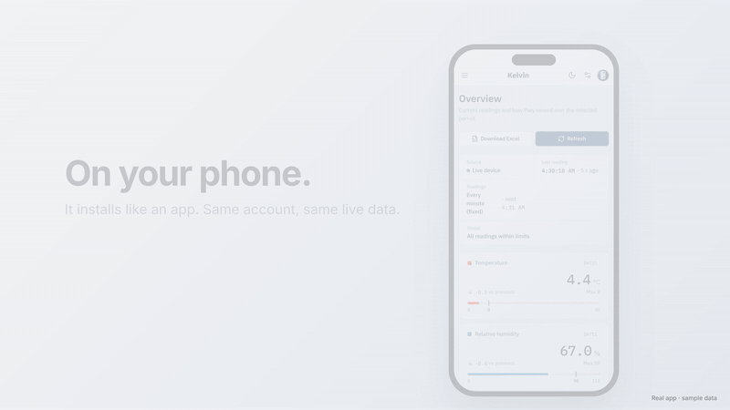<br>
<b>On your phone.</b> It installs like an app. Same account, same live data.
</div>

---

## 🧊 Features

| Area | What you get |
|---|---|
| **Live monitoring** | Temperature, humidity, eCO₂ and TVOC with your own limits. Charts over 24 hours, 3 days or 7 days, compared with the previous period. |
| **Forecast** | A trend line with a 95% confidence band, plus warnings like *"may cross the limit in about 45 minutes"*. |
| **Alerts** | Telegram and ntfy push alerts with a custom message template, a "back to normal" message, and an alert log. |
| **Energy** | Current, mAh per day and since power-on, an hour-by-hour chart, and cost per day and month. No power sensor needed. |
| **Data** | A searchable readings log and an Excel export with formatted cells, live formulas and charts. |
| **Fixed schedule** | The server saves exactly one reading a minute and tells the device when to send the next one. That is about 43,000 requests a month, inside Vercel's free plan. |
| **Accounts and teams** | Open sign-up with email confirmation, invitations, three roles (admin, operator, viewer), two-step sign-in, password reset and a PIN lock screen. |
| **Help, built in** | A live "How it works" diagram, a user guide, a six-step device setup, and one-sentence problem reports sent to the IT team's Telegram bot. |
| **Little things** | 12 badges, a cropped profile photo, a privacy blur, three languages, dark mode, and an installable PWA for phone and tablet. |

---

## 🔧 How it works

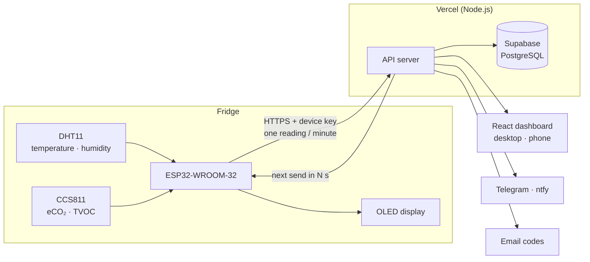

1. **The device.** An ESP32 reads the sensors and posts a reading over HTTPS with its own device key.
2. **The server** stores one reading per minute slot and tells the device how long to wait before the next one, so the schedule can't be changed from the website. It also checks the limits and sends alerts.
3. **The dashboard** shows the live data, the forecast and the energy estimate, and runs on any screen.

---

## 💡 Why this technology

| Choice | Why |
|---|---|
| **ESP32 + DHT11 + CCS811** | Wi-Fi built in, low cost and low power. Temperature and humidity, plus eCO₂ and TVOC, the gases that rise as food spoils. |
| **React + TypeScript (Vite)** | One fast app for desktop and phone, in three languages, light and dark, and installable as a PWA. |
| **Node.js on Vercel** | The same server code runs on a laptop and in the cloud, with HTTPS, a deploy on every push, and no server to look after. |
| **Supabase PostgreSQL** | A real SQL database. Every reading is kept, a week of averages comes back in one query, and every copy of the server shares it. |
| **Telegram, ntfy and email** | Free alerts on any phone with no app to build, plus email codes for new accounts and two-step sign-in. |

---

## 🔒 Security

- Passwords hashed with **scrypt**. An account locks after 5 wrong attempts.
- **HttpOnly** session cookies, a strict **Content Security Policy**, and **HSTS**.
- Email codes for new accounts and two-step sign-in, and an email when a new device signs in.
- A per-device key that can be rotated, and an encrypted vault for stored secrets.
- A security log for admins showing every sign-in and change.
- Secrets live only in environment variables. Nothing secret is in this repository (see [`.env.example`](.env.example)).

---

## 🚀 Run it yourself

Requires **Node.js 22+**.

```bash
git clone https://github.com/iraqi-man1/kelvin-smart-fridge.git
cd kelvin-smart-fridge
npm install
cp .env.example .env    # optional: database, email, Telegram
npm run dev             # http://localhost:5173
```

It starts with sample data, so you don't need a device or a database to try it. Without `DATABASE_URL` it stores data in local JSON files.

The full guide covers Supabase, Gmail, Telegram, ntfy, Vercel, roles and flashing the ESP32: **[docs/SETUP.md](docs/SETUP.md)**.

---

## 🗂️ Project structure

```
├── src/            React + TypeScript dashboard (pages, charts, forecast, Excel export)
├── server/         Node.js API: accounts, readings, schedule, alerts, mail, security
├── api/            Vercel function entry point
├── supabase/       Database schema
├── tests/          Unit tests (node --test) and end-to-end tests (Playwright)
├── promo-video/    The films, made in code with Remotion and FFmpeg
└── docs/           Setup guide, screenshots, GIFs and videos
```

---

## ✅ Tests

```bash
npm test            # 62 unit tests: accounts, sign-up, OTP, schedule, alerts, security, Vercel
npm run test:e2e    # browser tests with Playwright
```

---

<details>
<summary><b>نبذة بالعربي</b></summary>

<div dir="rtl">

**Kelvin** لوحة تحكم لثلاجة ذكية. جهاز **ESP32** يقرأ الحرارة والرطوبة (**DHT11**) وجودة الهواء (**CCS811**) ويرسلها للموقع كل دقيقة. الموقع يعرض القراءات مباشرة، ويتوقع القراءات الجاية، ويحسب استهلاك الطاقة، وينبّهك على **تلكرام** و **ntfy** قبل ما يخرب الأكل. يشتغل بثلاث لغات (العربي، English، Melayu)، وبالوضع الفاتح والداكن، وعلى الموبايل.

</div>
</details>

<div align="center">

**Designed and built by ALSARRAY ALI AHMED ALI** · Student project · Universiti Sains Malaysia

</div>
